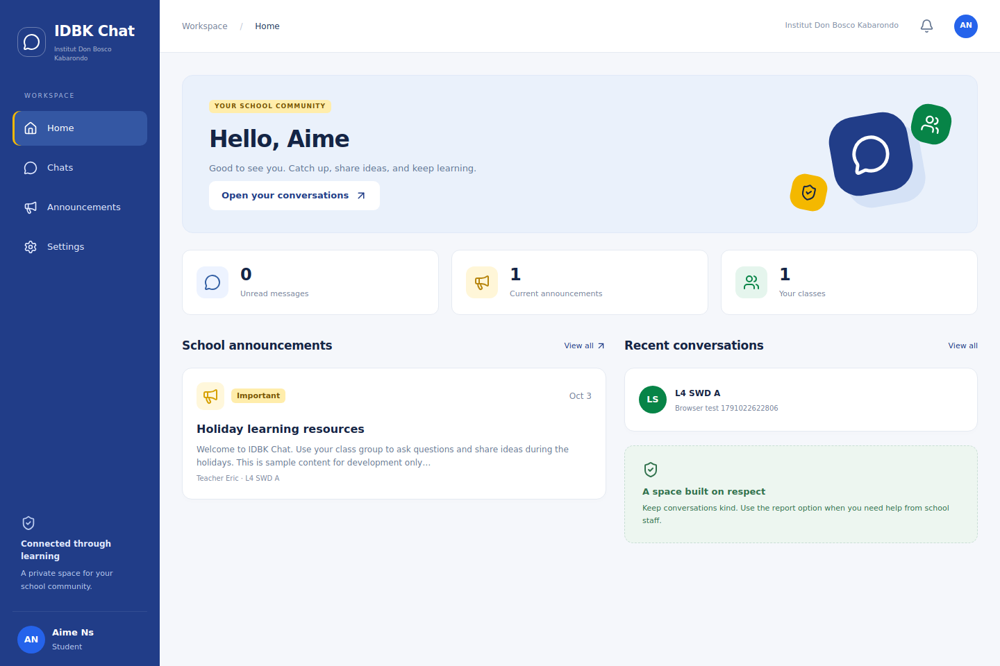

# IDBK Chat

A full-stack school communication MVP for students, teachers, school managers and administrators. Students can use it during holidays from a phone or desktop browser. Built around the accepted blue, green and yellow UI reference, with persistent chat and school-managed verification. This is a project implementation, not an officially deployed school service.

**Stack:** React + TypeScript + Tailwind CSS, Express + Socket.IO, Knex + MySQL 8.4. SQLite is included for an easy local preview. Node.js **24 LTS** is the supported runtime.



## Start locally in about five steps

Install Node.js 24, extract this project, then open a terminal in the `idbk-chat` folder:

```sh
npm ci
npm run setup
```

Open the generated `.env` file. Change `DB_CLIENT=mysql2` to `DB_CLIENT=sqlite`. Keep `APP_ORIGIN=http://localhost:3000`. The setup command generates a unique `ADMIN_PASSWORD`; there is no shared default password.

```sh
npm run db:migrate
npm run admin:create
npm run build
npm start
```

Open **http://localhost:3000**. Sign in with `ADMIN_USERNAME` and `ADMIN_PASSWORD` from `.env`. Create a class, set its actual expected student count, and invite a teacher from the administration screen. Students can register, sign in, and see their pending application. A reviewer must check school records before approving them.

The commands work in PowerShell and ordinary Unix terminals. If `better-sqlite3` cannot obtain a binary for your platform, install platform build tools or use the Docker option below.

**Local file uploads require ClamAV.** Uploads return an explanatory error when scanning is unavailable. For synthetic local demonstrations only, clear `CLAMAV_HOST` and set `DEV_ALLOW_UNSCANNED=true`. This opt-out is ignored in production. Development recovery emails are written privately under `data/mail/` when SMTP is not configured.

## Optional demo data

In `.env`, set `ALLOW_DEMO_SEED=true` and set `DEMO_PASSWORD` to a unique password of at least 12 characters. Then run:

```sh
npm run demo:seed
```

Sign in as `aime.demo`, `grace.demo`, or `teacher.demo` using that password. The seed creates a sample class, two approved students, a teacher, messages and an announcement. Run it on a disposable development database. It refuses production and existing demo usernames. Set `ALLOW_DEMO_SEED=false` afterward. Demo credentials, uploads and databases are **not** included in this archive.

## Docker with MySQL and ClamAV

Requirements: Docker Engine/Desktop with Compose, and Node.js 24 for the one-time configuration command. Allow at least 4 GB RAM for the stack; initial antivirus signatures can take several minutes to download.

```sh
node scripts/setup.mjs
docker compose up --build -d
docker compose exec app node dist/scripts/admin.js
```

Leave `DB_CLIENT=mysql2` in `.env` for this route. The application waits for MySQL and ClamAV health checks, then runs migrations. Open **http://localhost:3000** and use the generated administrator credentials. MySQL and scanner ports are private; the application binds to local loopback for use behind a reverse proxy.

```sh
docker compose logs -f app
docker compose down
```

`docker compose down` retains data volumes. Do not add `-v` unless you intend to delete the database and uploaded files. See [deployment](docs/DEPLOYMENT.md) before internet access.

## Included features

- Student registration with full name, username, claimed index number and class; optional recovery email.
- Pending, correction and rejected application screens; scoped human approval with evidence and capacity enforcement.
- Unique verified index numbers, duplicate claim warnings, teacher assignment, student transfers and class archive.
- Persistent class, direct and invitation-only group conversations; replies, read cursors, pagination and retry-safe sends.
- Own-message edits and removal within 15 minutes; invitation acceptance, owner transfer, group exit and blocking.
- Private PNG, JPEG and PDF message attachments, maximum 10 MB per file, with signature validation and ClamAV scanning.
- School-wide and class announcements, drafts, priorities, expiry display, revision-specific acknowledgement and recipient counts.
- In-app notifications and real-time refresh through Socket.IO, backed by an outbox and polling recovery.
- Reports with limited evidence, scoped moderation, account suspension, staff invitations and audit trail.
- Email verification, reset links, password change and an audited operator recovery command for students without email.
- Responsive desktop/mobile UI, keyboard-operable dialogs, loading, error and empty states.

Class capacity is a reconciliation control, **not identity proof**. A pending registration never reserves a place or owns a student number.

## Project organization

| Path                             | Responsibility                                                       |
| -------------------------------- | -------------------------------------------------------------------- |
| `apps/web/src/app`               | App shell, routes, session bootstrap and navigation                  |
| `apps/web/src/features`          | Home, chat, notices, administration, settings and reports            |
| `apps/web/src/components`        | Reusable interface elements and forms                                |
| `apps/web/src/lib`               | API and refresh helpers                                              |
| `apps/api/src/modules`           | Auth, school, conversations, messages, notices, files and moderation |
| `apps/api/src/policies`          | Class scope, membership, block and notice access rules               |
| `apps/api/src/infrastructure`    | Database, mail, storage and audit/outbox helpers                     |
| `apps/api/src/realtime` / `jobs` | Session-aware sockets and background delivery/cleanup                |
| `packages/contracts`             | Shared request validation schemas                                    |
| `database/migrations`            | Versioned relational schema                                          |
| `scripts`                        | Configuration, migration, bootstrap, seed and recovery commands      |
| `tests`                          | API integration and browser tests                                    |
| `infra`                          | Container build definition                                           |
| `docs`                           | Architecture, API, operations, verification and screenshots          |

## Development and tests

For Vite development, set `APP_ORIGIN=http://localhost:5173` in `.env`, then run `npm run dev`. Open **http://localhost:5173**. Vite proxies requests and sockets to port 3000. Switch the origin back to port 3000 for the production build served locally.

```sh
npm run build
npm test
npm run format:check
```

`npm test` creates and removes an isolated SQLite database. MySQL integration requires a separate empty database with `TEST_DB_CLIENT=mysql2` and the corresponding `DB_*` variables; never point tests at live data. GitHub Actions includes both SQLite and MySQL jobs.

Browser tests require the seeded app running on port 3000. Set `E2E_PASSWORD` in your shell to the demo password, then:

```sh
npx playwright install chromium --only-shell
npm run test:e2e
```

Without `E2E_PASSWORD`, browser tests skip explicitly. See [verification](docs/VERIFICATION.md) for tests actually run on this delivery.

## Documentation and release boundaries

- [Architecture and data model](docs/ARCHITECTURE.md)
- [API routes](docs/API.md)
- [Deployment, backup and recovery](docs/DEPLOYMENT.md)
- [School administrator guide](docs/ADMIN_GUIDE.md)
- [Implemented scope and next steps](docs/SCOPE.md)
- [Verification record](docs/VERIFICATION.md)

This is a runnable MVP source release. Production use requires your own hosting, domain/HTTPS, SMTP, scanner, backups and school acceptance testing. MySQL/Docker and live SMTP/ClamAV integration are provided but were not exercised in the build environment. No school API, Figma connection, external account or deployment is required to inspect the project.
