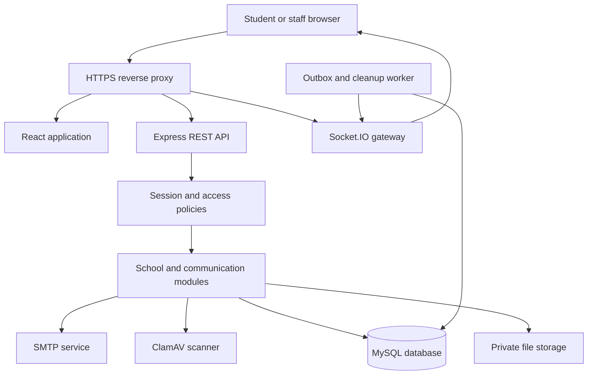
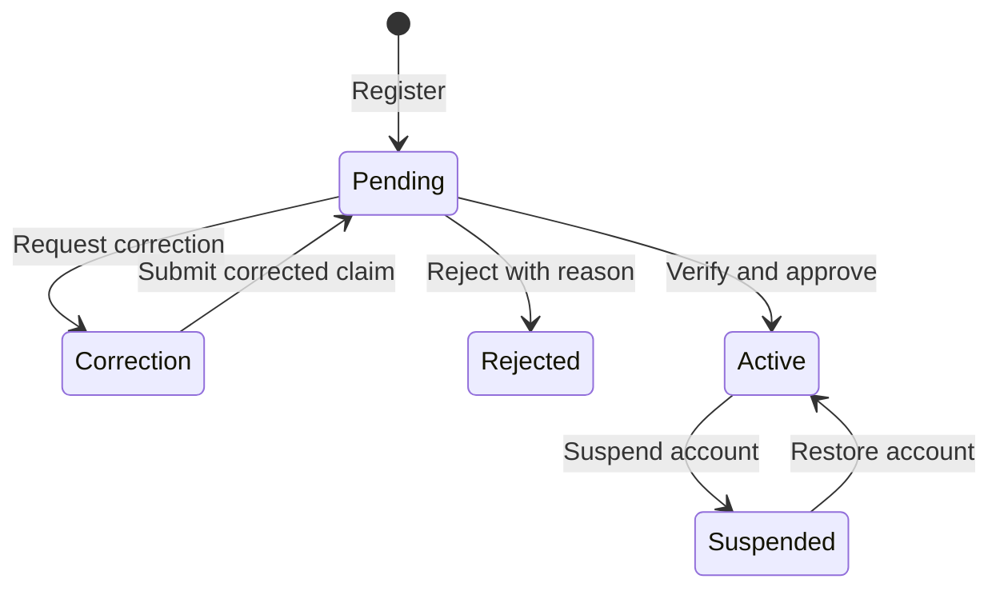
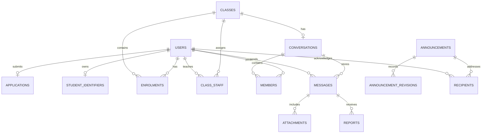

# Architecture

## Runtime structure

The system is a TypeScript modular monolith: one application process exposes REST, serves the built React app, authenticates WebSocket connections and runs its outbox worker. Domain modules share a transactional relational database. Keep one app instance for this MVP.

React is served by Express after `npm run build`. During development, Vite proxies `/api` and `/socket.io`. Same-origin cookies avoid storing bearer tokens in browser storage. Mutations use HTTP with CSRF protection; sockets send an invalidation event, and the browser refetches through authorized REST routes. Socket delivery is a prompt to refresh, not a durable message channel.

## Domain boundaries

Auth owns sessions, verification and recovery. School owns classes, identity claims, student number ownership, enrolments and staff scope. Conversations own memberships and invitations. Messages own ordered text, replies and attachment links. Announcements own revisions and acknowledgement audiences. Moderation owns blocks, reports and resolutions. Shared infrastructure handles storage, mail, audit and transactional outbox entries.

Route modules validate inputs with Zod, enforce policies, perform transactions and serialize responses. Shared contracts hold the core registration, message and announcement schemas. Local schemas cover administrative actions. Database access remains inside the backend.

## Identity and approval

A public applicant chooses a username and submits a claimed index number. Claims can duplicate so that someone impersonating a student cannot prevent the real student applying. Only approval inserts the globally unique number into `student_identifiers`. Leading zeroes are retained because numbers are strings.

Reviewers compare the name and claimed number to trusted school records. For approval, one transaction locks the pending application and class, checks reviewer scope, checks number ownership and current enrolment capacity, creates enrolment and class membership, activates the user, records evidence and commits. Competing approvals cannot consume the same final class place. A conflicting verified number fails on the database constraint and requires investigation.

Email verification establishes control of a recovery mailbox. It does not approve school membership. Holiday access uses the same login and policies as term-time access. The implementation does not rely on access to the school network or API.

## Core relationships

The migration is the authoritative physical schema. IDs are application-generated UUID strings and timestamps are epoch milliseconds in BIGINT columns. This supports both MySQL and the local SQLite preview without different domain logic. Foreign keys, composite keys and unique constraints enforce relationships. Additional tables handle sessions, single-use tokens, invitations, blocks, notifications, audits and the outbox.

## Communication guarantees

- A message has a UUID client id and a hash of its original payload. A retry with the same id and payload returns the saved record. Reusing the id with different content returns 409.
- The conversation row is locked before assigning its next sequence number. History is ordered by sequence, not client clocks.
- Each membership records the sequence when it joined and its monotonic read cursor. New members cannot fetch earlier messages. A rejoining membership begins at its new join sequence.
- Leaving a group, transfer, teacher removal or class archive revokes the applicable conversation access. Suspension deletes sessions. Socket sessions are checked periodically.
- Direct conversations between classmates open immediately. Other direct contact requires acceptance. Blocks stop direct sends and new invitations; they do not hide shared class messages.
- Private group owners manage invitations and removal. Owners must transfer ownership before leaving a nonempty group. Invitations are one per recipient per conversation in this MVP; declined or ended memberships cannot be reinvited through the current UI.
- Announcement publication snapshots active recipients. Each edit creates a new revision and acknowledgement audience. Previous acknowledgements do not count for a new revision. Current authorized members can read applicable notices, but only snapshot recipients acknowledge them.
- Files stay outside the public static directory. Download checks current membership, join sequence and message deletion. Only actual PNG/JPEG/PDF signatures are accepted; scans fail closed.

## Deployment and growth

The default deployable stack is a single Node container, MySQL 8.4, ClamAV and a reverse proxy. Uploads use a private local volume. MySQL is the intended production database; SQLite is a local demo/test convenience. Sessions and outbox records survive process restarts. In-app notifications and periodic HTTP refresh recover missed socket events.

Before multiple app instances, add an appropriate Socket.IO adapter, coordinated outbox claiming, shared object storage and distributed rate limits. Add indexes and pagination after measuring representative school data; some administration lists and notice queries are intentionally bounded/simple for the MVP. Do not assume measured throughput: no production load target has been validated.

## Deliberate implementation choices

One role per account; role plus class scope plus membership authorize actions. Staff have no general private-message browser. Reported evidence is limited to a small context window. The database is not end-to-end encrypted; authorized server operators can access stored data. Use encrypted disks/backups and TLS on infrastructure connections where appropriate.

The earlier design's possible Redis, S3, multiple roles, roster integration and separate workers are extension points, not claimed implementations. The accepted visual reference informs the responsive layout and school palette; no Figma prototype was imported.
